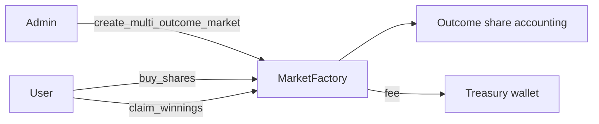

# Raize_contracts_multioutcome

### Multi-outcome prediction market contracts for Raize Club on Starknet

 

`MarketFactory` is a Cairo contract that creates prediction markets with more than two outcomes. Users buy outcome shares, and winners claim payouts after resolution. The platform takes a fee into a treasury wallet.

| Area | Functions |
|---|---|
| Markets | `create_multi_outcome_market`, `create_share_tokens`, `get_market`, `get_all_multioutcome_markets`, `get_multi_outcome_market_count` |
| Trading | `buy_shares`, `get_outcome_and_bet`, `get_num_bets_in_market` |
| Settlement | `claim_winnings` |
| Admin | `add_admin`, `check_is_admin`, `get_owner`, `get_platform_fee`, `get_treasury_wallet` |



```bash
cd raize_multioutcome
scarb build
snforge test
```
